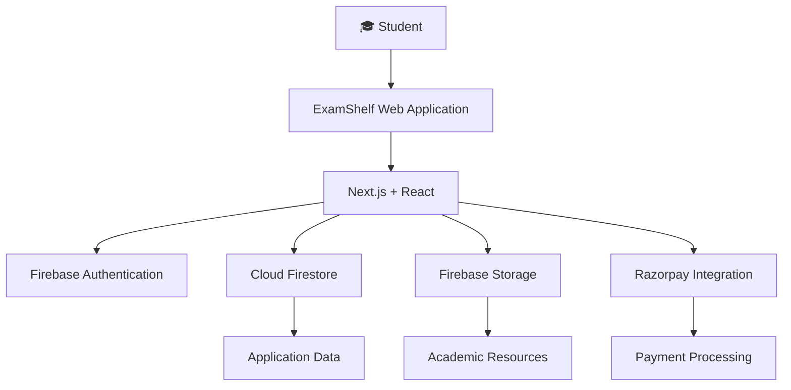

 
<div align="center">

# 📚 ExamShelf

### Your Academic Resources. One Shelf.


<p>
  <b>A platform built to make academic preparation more organized and accessible.</b>
</p>

<p>
  <a href="https://examshelf.in">
    
  </a>
  <a href="https://github.com/Aradhy2005/examshelf-f">
    
  </a>
</p>

<p>
  
  
  
  
  
</p>

</div>

---

## ✨ About ExamShelf

Finding the right academic material shouldn't be difficult.

Students often spend valuable preparation time searching across multiple platforms for organized notes, study materials, and exam-oriented resources. ExamShelf aims to make that experience simpler by bringing academic resources together in one place.

**ExamShelf** is an academic resource platform designed to help students discover and access study materials through an organized digital experience.

Whether you're preparing for university examinations or revising a particular subject, ExamShelf aims to make your study resources easier to find and access.

## 🎯 Why ExamShelf?

- 📖 **Organized Learning Resources** — Explore academic materials through a structured platform.
- 🎓 **Student-Focused Experience** — Designed around the needs of students and their preparation workflows.
- 🔍 **Resource Discovery** — Navigate available academic resources with a focused interface.
- 🔐 **Authentication** — Firebase-powered user authentication.
- 💳 **Online Payments** — Razorpay integration for supported paid resources.
- 📱 **Responsive Interface** — A web experience designed for different screen sizes.

## 🚀 Platform Overview

<div align="center">

| Discover | Access | Learn |
|:---:|:---:|:---:|
| Explore available academic resources | Access resources through the platform | Use materials for preparation and revision |
| 📚 | 🔐 | 🎯 |

</div>

## 🛠️ Tech Stack

The original ExamShelf production repository is built with the following technologies:

| Technology | Purpose |
|---|---|
| **Next.js** | React framework and application routing |
| **React** | Component-based user interface |
| **TypeScript** | Type-safe application development |
| **Tailwind CSS** | Styling and responsive UI |
| **Firebase Authentication** | User authentication |
| **Cloud Firestore** | Database services |
| **Firebase Storage** | File and resource storage |
| **Razorpay** | Payment integration |
| **React PDF** | PDF document rendering |
| **Recharts** | Data visualization |
| **Framer Motion** | UI animations |

## 🏗️ High-Level Architecture



## ⚙️ Getting Started

Follow these steps to run the project locally.

### Prerequisites

Make sure you have installed:

- [Node.js](https://nodejs.org/)
- npm
- Git

### 1. Clone the repository

```bash
git clone https://github.com/Aradhy2005/examshelf-f.git
```

### 2. Navigate to the project

```bash
cd examshelf-f
```

### 3. Install dependencies

```bash
npm install
```

### 4. Configure environment variables

Create a `.env.local` file in the root directory.

Add the environment variables required by the application. Refer to the Firebase, Razorpay, and other service integrations in the source code to identify the exact variable names and configuration values.

**Important:** Never commit private service-account credentials, Razorpay secrets, webhook secrets, or other sensitive environment values.

### 5. Start the development server

```bash
npm run dev
```

Open [http://localhost:3000](http://localhost:3000) in your browser.

## 📁 Project Structure

The application is organized around the Next.js application structure, reusable UI components, and service integrations.

```text
examshelf-f/
│
├── public/                 # Static assets
│
├── src/                    # Application source code
│   ├── app/                # Next.js application routes
│   ├── components/         # Reusable UI components
│   └── ...                 # Supporting modules
│
├── .gitignore
├── eslint.config.mjs
├── next.config.ts
├── package.json
├── tsconfig.json
└── README.md
```

*Note: This is a high-level overview, not an exhaustive listing of every source directory.*

## 🔒 Security & Responsible Configuration

ExamShelf integrates with Firebase and Razorpay. Secure configuration is essential.

- Keep private API secrets and service-account credentials out of source control.
- Configure Firestore and Firebase Storage security rules according to application access requirements.
- Validate payment results on trusted server-side code.
- Restrict administrative operations to authorized users.
- Avoid exposing private documents through unrestricted public storage access.
- Keep dependencies updated and review security advisories.

Firebase client configuration values are not equivalent to private service-account credentials. Actual data security depends on correctly configured access controls and server-side validation.

## 🧑‍💻 Development Commands

| Command | Description |
|---|---|
| `npm run dev` | Start the development server |
| `npm run build` | Create a production build |
| `npm run start` | Start the production server |
| `npm run lint` | Run ESLint checks |

## 🌱 Project Vision

ExamShelf is built around a simple idea:

> Make academic resources easier to discover, access, and use.

The long-term vision is to build a more organized academic ecosystem where students can find useful learning resources without unnecessary friction.

## 🤝 Contributing

Suggestions, bug reports, and improvements are welcome.

If you would like to contribute:

1. Fork the repository.
2. Create a new branch.
3. Make your changes.
4. Test your changes.
5. Submit a pull request with a clear description.

## 📬 Connect

<div align="center">

**Built with ❤️ for students.**

<a href="https://examshelf.in">Website</a> •
<a href="https://github.com/Aradhy2005">GitHub</a> •
<a href="https://www.linkedin.com/in/aradhy-bajpai-897241283/">LinkedIn</a>

<br/>


</div>

---

<div align="center">
  <sub>ExamShelf — Your Academic Resources. One Shelf.</sub>
</div>
